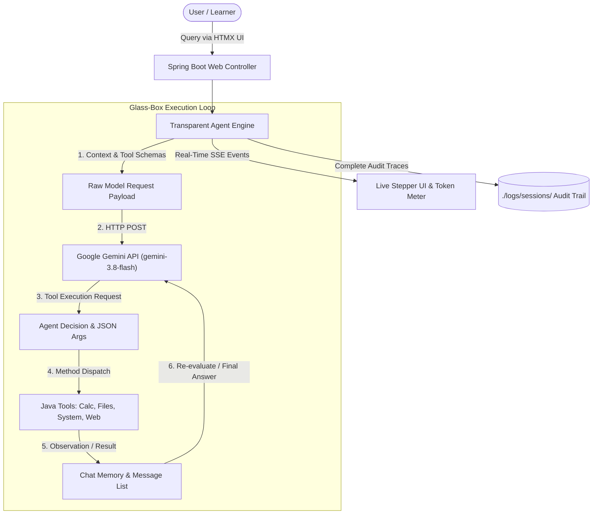

# AI Mini-Agent Workshop: Glass-Box Agent Platform

[](https://openjdk.org/)
[](https://spring.io/projects/spring-boot)
[](https://github.com/langchain4j/langchain4j)
[](https://ai.google.dev/)
[](https://modelcontextprotocol.io/)
[](#-license)
[](#-running-tests)

An educational, open-source Java & Spring Boot mini-agent platform powered by **LangChain4j 1.22**, **Google Gemini (gemini-3.8-flash)**, **HTMX**, and **Bootstrap 5**.

Designed specifically to **demystify how AI agents work under the hood** by exposing every micro-step of the ReAct reasoning cycle, parameter negotiation, local method reflection, observation injection, Model Context Protocol (MCP) wire traffic, token consumption, and disk auditing.

---

## 📑 Table of Contents

- [Why This Project?](#-why-this-workshop-project)
- [Architecture & ReAct Flow](#-architecture--react-flow)
- [Dual-Engine Modes](#-dual-mode-classic-in-process-vs-model-context-protocol-mcp)
- [Key Features & Components](#-key-features--components)
- [Quick Start](#-quick-start)
  - [1. Prerequisites](#1-prerequisites)
  - [2. Clone & Configure API Key](#2-clone--configure-api-key)
  - [3. Run the Application](#3-run-the-application)
  - [4. Sample Prompts to Try](#4-sample-prompts-to-try)
- [Workshop Curriculum](#-workshop-documentation-curriculum)
- [Hands-on Exercises Overview](#-hands-on-exercises-overview)
- [Observability & Disk Audit Logging](#-observability--disk-audit-logging)
- [Project Structure](#-project-structure)
- [Running Tests](#-running-tests)
- [License](#-license)

---

## 🌟 Why This Workshop Project?

Most agent frameworks and tools operate as opaque "black boxes," leaving engineers confused about:
- *How does the LLM actually decide when and how to call a tool?*
- *What does the exact raw JSON payload sent to the LLM look like?*
- *How does context window growth, prompt caching, and token pricing accumulate during a multi-step task?*
- *How does the Model Context Protocol (MCP) decouple tools across processes using JSON-RPC 2.0?*
- *How do we audit and log every step to disk for compliance, determinism, and debugging?*

This project provides a **100% transparent ("Glass-Box") engine** with a real-time reactive UI, live SSE streams, and comprehensive disk logging.

---

## 🏗 Architecture & ReAct Flow



---

## 🔌 Dual-Mode: Classic In-Process vs. Model Context Protocol (MCP)

Switch between two execution paradigms with a single click in the navigation bar:

### 1. Classic Demo (In-Process Java Tools)
- Tools are standard Spring beans annotated with LangChain4j's `@Tool`.
- Parameter binding and method execution occur via Java reflection within the application JVM.
- Perfect for understanding the core ReAct loop, schema generation, and reflection dispatch.

### 2. MCP Demo (Client-Server Protocol)
- The agent acts as an **MCP Client** communicating over **JSON-RPC 2.0**.
- Tools are dynamically discovered via `tools/list` and executed across isolated MCP servers:
  - **Local MCP Server** (`LocalMcpServer`): Exposes mathematical calculation, system diagnostics, and file inspection over JSON-RPC. Also runnable as an external process over standard I/O (`stdio`).
  - **Open-Meteo Weather MCP Server** (`OpenMeteoWeatherMcpServer`): Live global weather forecasting and geocoding via Open-Meteo REST APIs (**zero API keys required**).
  - **Diagnostic Remote MCP Endpoint**: Demonstrates cloud-hosted MCP endpoint monitoring and error isolation.
- Full JSON-RPC request/response payloads and sub-millisecond latencies are rendered in collapsible purple wire drawers in the UI.

---

## 🔬 Key Features & Components

| Component | Description |
|---|---|
| **Two-Pane Glass-Box Dashboard** | Left: Interactive Chat with prompt presets. Right: Live ReAct execution timeline, step-by-step inspector, and token meters. |
| **Dual-Mode Engine Toggle** | Switch seamlessly between **Classic In-Process Agent** and **Model Context Protocol (MCP) Agent**. |
| **Interactive MCP Hub & Wire Inspector** | Built-in modal dialog displaying active MCP servers, registered tool schemas (`tools/list`), and microsecond-level wire traffic (`mcp_traffic.jsonl`). |
| **Real-Time Streaming (SSE)** | Steps and wire events broadcast live from Java to browser via Server-Sent Events (`/api/stream/{sessionId}`). |
| **Full Disk Audit Logging** | Every turn is saved to `./logs/sessions/{sessionId}/` with `summary.json`, `trace_events.jsonl`, `raw_payloads.json`, `mcp_traffic.jsonl`, and human-readable `transcript.md`. |
| **Extensible Tool Suites** | Classic Java `@Tool` suite + Dual MCP Servers (Local System/Math/Files server + Live Open-Meteo Weather server). |
| **Configurable Model & Thinking Budget** | Defaults to `gemini-3.8-flash` with `medium` thinking budget. Also supports `gemini-3.7-flash`, `gemini-3.5-flash-lite`, `gemini-3.1-flash-lite`, `gemini-2.5-pro`, and an offline mock engine. |

---

## 🚀 Quick Start

### 1. Prerequisites
- **Java 21+** installed (`java -version`)
- **Maven 3.9+** installed (`mvn -version`)
- A **Google Gemini API Key** (or run offline with the built-in Mock Agent!)

### 2. Clone & Configure API Key

```bash
# Clone the repository
git clone https://github.com/xceptance/ai-mini-agent-workshop.git
cd ai-mini-agent-workshop
```

Configure your Gemini API key in any of the following ways (evaluated in priority order):

1. **Local File (Recommended for local dev):** Create an `api.key` file in the project root:
   ```bash
   echo "AIzaSy..." > api.key
   ```
2. **Environment Variable:**
   ```bash
   export GEMINI_API_KEY="AIzaSy..."
   ```
3. **Application Properties:** Edit `src/main/resources/application.yml` or pass `-Dgemini.api-key=...`
4. **Offline Mock Mode:** If no key is detected, the application automatically launches in **Offline Mock Mode**, allowing you to explore the UI and execution lifecycle without external credentials!

### 3. Run the Application

```bash
mvn spring-boot:run
```

Open your browser to: **[http://localhost:8080](http://localhost:8080)**

### 4. Sample Prompts to Try

- **Math & Date Tool Execution:**
  > *"What is 453 * 289, and what is the current date and time?"*
- **File System Inspection:**
  > *"Inspect pom.xml and tell me which version of LangChain4j is configured."*
- **Model Context Protocol (MCP Mode):**
  > Switch to MCP mode in the navbar and ask: *"What is the weather like in Tokyo right now?"*
- **Multi-Step Reasoning:**
  > *"Check the system memory and disk space, then calculate how many megabytes are free."*

---

## 📚 Workshop Documentation Curriculum

Comprehensive conceptual and practical guides are available in the [`docs/`](docs/) directory:

1. **[01. What is an AI Agent?](docs/01_WHAT_IS_AN_AGENT.md)** — Core theory, LLM vs. Agent, ReAct loop, context window mechanics, and prompt engineering.
2. **[02. How Tool Calling Works](docs/02_HOW_TOOL_CALLING_WORKS.md)** — JSON Schema generation, parameter binding, reflection dispatch, and observation injection.
3. **[03. LangChain4j Architecture](docs/03_LANGCHAIN4J_ARCHITECTURE.md)** — High-level `AiServices` declarative abstractions vs. low-level transparent Java loops.
4. **[04. Observability & Token Logging](docs/04_OBSERVABILITY_AND_LOGGING.md)** — Inspecting disk traces, token meters, cache hits, cost accounting, and debugging loops.
5. **[05. Workshop Exercises & Solutions](docs/05_WORKSHOP_EXERCISES.md)** — 13 hands-on progressive coding challenges covering tools, OpenSpec SDD, AGENTS.md, mutation testing, and MCP servers.
6. **[06. Quality Work with Agents](docs/06_QUALITY_WORK_WITH_AGENTS.md)** — The 4 Pillars of Agentic Quality: History, Context, Specs (OpenSpec), and Deterministic Engineering Workflows.
7. **[07. Model Context Protocol (MCP)](docs/07_MODEL_CONTEXT_PROTOCOL_MCP.md)** — MCP architectural deep dive, JSON-RPC 2.0 wire protocol, tool negotiation, transports (`stdio` vs `http`), and building custom MCP servers in Java.
8. **[Workshop Master Planning & Catalog](docs/workshop-planning.md)** — Modular workshop profiles, master content catalog, open standards, and organizational playbooks.

---

## 🛠 Hands-on Exercises Overview

The workshop includes practical, progressive exercises (detailed in [`docs/05_WORKSHOP_EXERCISES.md`](docs/05_WORKSHOP_EXERCISES.md)):

```
┌─────────────────────────────────────────────────────────────────────────────┐
│ 1. THE WILD WEST (LRUClockMap)                                              │
│    Prompt an unconstrained agent on a zero-allocation hash map. Witness      │
│    flaky timing tests, broken cache locality, and deleted test assertions.  │
├─────────────────────────────────────────────────────────────────────────────┤
│ 2. DISCIPLINED ENGINEERING (AGENTS.md + TDD + Mutation Testing)              │
│    Apply strict guardrails, characterization tests, and JaCoCo / Pitest to   │
│    kill surviving mutants and guarantee high-assurance agent output.        │
├─────────────────────────────────────────────────────────────────────────────┤
│ 3. SPEC-DRIVEN APPLICATION ("CueCards" + OpenSpec + MCP)                     │
│    Design and build a collaborative memory board with OpenSpec, expose it   │
│    over an MCP Server, and interact live with external agents via JSON-RPC. │
└─────────────────────────────────────────────────────────────────────────────┘
```

---

## 🔍 Observability & Disk Audit Logging

Every agent run writes a full audit trail to `./logs/sessions/{sessionId}/`:

```
logs/sessions/d921b714-3d96-4eb1-995c-7d9219df08f3/
├── summary.json          # Overall duration, total token usage, cached counts, and status
├── transcript.md         # Formatted, human-readable record of reasoning and dialogue
├── trace_events.jsonl    # Granular micro-step timeline with millisecond timestamps
├── raw_payloads.json     # Unedited HTTP request/response payloads exchanged with Gemini
└── mcp_traffic.jsonl     # Exact JSON-RPC 2.0 wire frames (requests, responses, latency)
```

> [!TIP]
> You can inspect these logs directly inside the running application using the built-in **Log Viewer Modal** or open them in your IDE for offline auditing.

---

## 📂 Project Structure

```
ai-mini-agent-workshop/
├── pom.xml                                   # Spring Boot 4.1 & LangChain4j 1.22 dependencies
├── README.md                                 # Workshop documentation & quick start guide
├── api.key.example                           # Example Gemini API key template
├── docs/                                     # In-depth educational guides & exercises
│   ├── 01_WHAT_IS_AN_AGENT.md                # ReAct loop, context window, agent theory
│   ├── 02_HOW_TOOL_CALLING_WORKS.md          # JSON Schemas, parameter binding, reflection
│   ├── 03_LANGCHAIN4J_ARCHITECTURE.md        # LangChain4j abstractions vs manual Java loop
│   ├── 04_OBSERVABILITY_AND_LOGGING.md       # Traces, tokens, cost accounting, debug techniques
│   ├── 05_WORKSHOP_EXERCISES.md              # 13 hands-on progressive coding exercises
│   ├── 06_QUALITY_WORK_WITH_AGENTS.md        # The 4 Pillars: History, Context, Specs, Determinism
│   ├── 07_MODEL_CONTEXT_PROTOCOL_MCP.md      # MCP Architecture, JSON-RPC 2.0 wire protocol
│   └── workshop-planning.md                  # Workshop profiles, master content catalog & playbooks
├── src/main/java/com/workshop/agent/
│   ├── MiniAgentWorkshopApplication.java     # Spring Boot entry point
│   ├── config/                               # Gemini & ApiKey discovery configuration
│   ├── engine/                               # TransparentAgentEngine & McpAgentEngine ReAct loops
│   ├── logging/                              # Disk audit logger, Markdown transcripts, ANSI logs
│   ├── mcp/                                  # Model Context Protocol implementation
│   │   ├── client/                           # McpClientManager (discovery, schema mapping, dispatch)
│   │   ├── model/                            # McpProtocolMessage, McpWireRecord, McpServerConfig
│   │   └── server/                           # LocalMcpServer & OpenMeteoWeatherMcpServer
│   ├── model/                                # Events, Session state, Token metrics, DTOs
│   ├── tools/                                # Java @Tool components & reflection registry
│   ├── util/                                 # MarkdownRenderer and formatting helpers
│   └── web/                                  # HTMX endpoints, SSE streams, REST controllers
├── src/main/resources/
│   ├── application.yml                       # Agent properties, prompts & model configuration
│   ├── logback-spring.xml                    # Logging configuration
│   ├── static/                               # Glass-box CSS styles and reactive JavaScript
│   └── templates/                            # Thymeleaf & HTMX templates (modals, drawers, steps)
└── logs/sessions/                            # Generated disk audit traces per session
```

---

## 🧪 Running Tests

Run the complete test suite (unit tests, integration tests, MCP tests, mock validations):

```bash
mvn clean test
```

All 52 tests execute in under 20 seconds, validating tool reflection, JSON-RPC protocol serialization, session persistence, and agent reasoning cycles without requiring active network credentials.

---

## 📄 License

This project is licensed under the [MIT License](https://opensource.org/licenses/MIT). Created for AI Agent Workshops & Educational Demonstrations.
