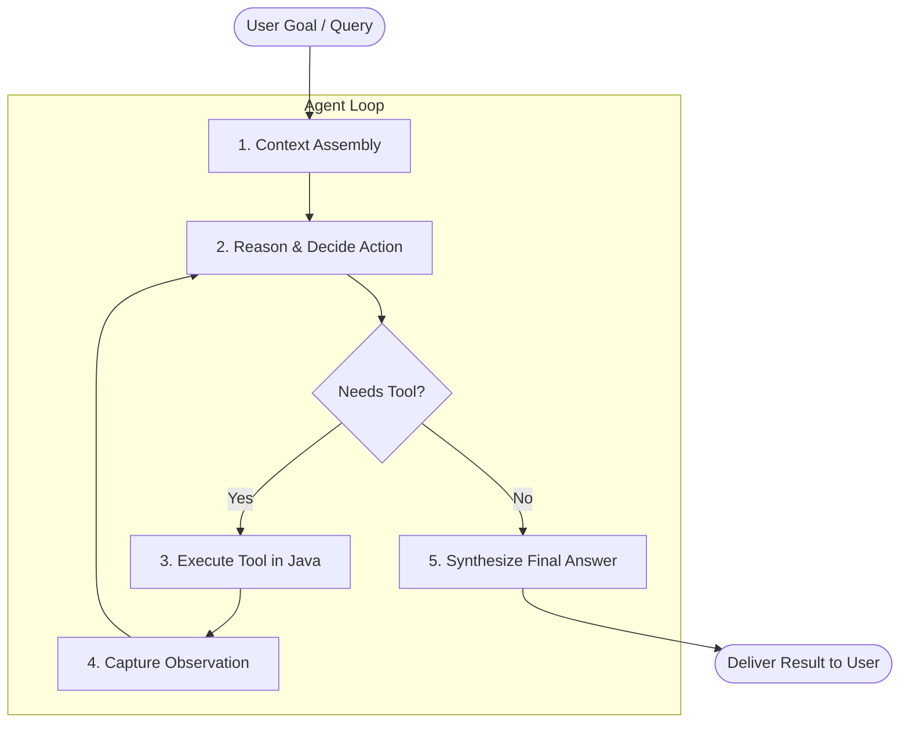

# 01. What Is An AI Agent? (Under-The-Hood Fundamentals)

## 1. Introduction: From Static LLM to Autonomous Agent

A standard Large Language Model (LLM) is a **stateless prediction engine**. Given an input sequence of tokens (a prompt), it predicts the most probable next tokens based purely on its static training weights:

$$\text{Prompt} \longrightarrow \text{LLM} \longrightarrow \text{Static Output}$$

While remarkably capable at writing, summarizing, and reasoning, a raw LLM has critical limitations:
1. **Knowledge Cutoff**: It cannot know facts, news, or system events that occurred after its training date.
2. **Deterministic Computation Deficit**: It often hallucinates complex arithmetic, precise dates, or cryptographic calculations.
3. **No Environmental Agency**: It cannot interact with databases, query APIs, inspect files, or execute actions on your computer.

### What is an AI Agent?
An **AI Agent** combines an LLM (the reasoning *brain*) with a set of tools (the *hands and senses*) and an execution loop (the *nervous system*) that enables the agent to take actions, observe feedback, and iterate toward a goal:



---

## 2. The ReAct Pattern (Reasoning + Acting)

The most foundational architecture for modern AI agents is the **ReAct (Reason + Act)** pattern (Yao et al., 2022). 

Instead of generating an answer in a single shot, the agent alternates between **internal thought**, **external action**, and **environmental observation**:

| Stage | What Happens | Example in our Java Workshop Agent |
|---|---|---|
| **Thought** | The model assesses what it knows and what it still needs to find out. | *"I need to know the current time and available memory on the server."* |
| **Action** | The model requests the execution of a specific tool with JSON arguments. | `getCurrentDateTime(timezone="UTC")` |
| **Observation** | The Java runtime executes the tool and feeds the result back into the prompt. | `"Current Server Date/Time: 2026-08-18 14:50:00 UTC"` |
| **Synthesis** | The model reviews the observation and either requests another tool or produces the final response. | *"The server is currently running at 14:50 UTC with 512MB memory free."* |

---

## 3. The Context Window & Conversation Accumulation

Under the hood, an agent does **not** possess long-term internal memory. Every iteration of the ReAct loop is simply a new HTTP request sent to the model, containing an increasingly long list of messages:

```
[SystemMessage] "You are an agent with access to tools..."
[UserMessage]   "What is 144 * 12 + the square root of 625?"
[AiMessage]     ToolExecutionRequest: calculate(operation="MULTIPLY", a=144, b=12)
[ToolResult]    "1728.0"
[AiMessage]     ToolExecutionRequest: powerOrRoot(type="SQRT", base=625, exponent=0)
[ToolResult]    "25.0"
[AiMessage]     ToolExecutionRequest: calculate(operation="ADD", a=1728, b=25)
[ToolResult]    "1753.0"
[AiMessage]     "144 * 12 is 1,728, and the square root of 625 is 25. Adding them gives 1,753."
```

### Key Insight for Learners:
Every tool execution appends **two new messages** to the context window:
1. The assistant's `AiMessage` declaring which tool to call.
2. The runtime's `ToolExecutionResultMessage` containing the output.

As a result, token consumption grows with every tool call. Tracking prompt vs. completion tokens is essential for production agents.

---

## 4. Why Most Agents are Opaque "Black Boxes"

Most commercial agents hide this internal conversation. When you type a query into a typical agent UI, you only see the final response (or a vague "Searching the web..." spinner).

This opacity leads to common frustrations:
- Why did the agent take 15 seconds?
- Which tool did it invoke?
- Did the tool return an error that the model silently tried to work around?
- How many tokens did this query cost?

In this **AI Mini-Agent Workshop**, our **Glass-Box Engine** reveals every stage in real-time in the UI and writes full audit logs to disk (`./logs/sessions/`).
