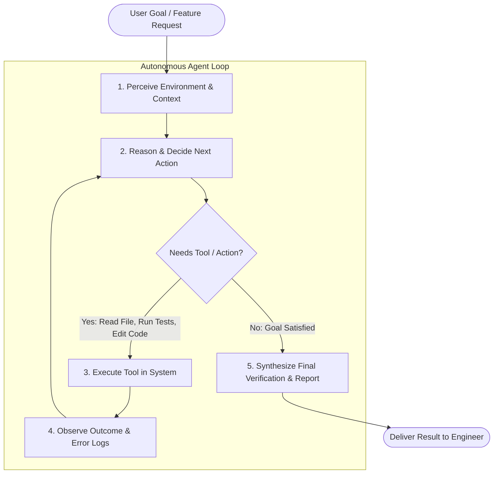

# 01. What Is An AI Agent? (Foundations & Architecture)

## 1. Demystifying AI in General: Classical Code vs. Probabilistic Systems

To understand AI agents, we do not need to dive into complex neural network mathematics, tensor shapes, or transformer formulas. Instead, we need a clean mental model of how modern AI differs from traditional software:

* **Classical Software (Deterministic Rules):** Built on explicit instructions (`if/else`, loops, SQL queries). If conditions A and B are met, it deterministically executes action C. It is 100% predictable, but completely brittle when faced with ambiguous human intent or messy real-world text.
* **Modern AI (Probabilistic Reasoning):** Learns statistical patterns and reasoning structures across vast amounts of human language and code. It excels at understanding messy context, summarizing complex ideas, and translating between formats—but its responses are inherently probabilistic and variable.
* **What Modern AI Is (and Is Not):**
  * *It IS:* An extraordinary reasoning, synthesis, and language translation engine.
  * *It IS NOT:* An infallible calculation engine, a database of verified facts, or a conscious mind.
* **The Fundamental Boundary:** Raw AI sitting in isolation cannot see your filesystem, cannot execute terminal commands, cannot check the current date/time, and cannot verify if its own statements actually compile or run.

---

## 2. Chat AI: The Conversational Dialogue Partner (And the Human Bottleneck)

Most people first experience modern AI through **Chat AI** (e.g., ChatGPT or Claude Web):

* **The Sandbox Model:** A chat interface is an isolated text-in, text-out sandbox. The AI sits passively waiting for a prompt, generates a response, and stops.
* **The "Human-as-the-Glue" Problem:** In software development, using pure Chat AI creates an exhausting manual workflow:
  1. The human developer copies project code into the prompt.
  2. The AI generates a suggested fix or new function.
  3. The developer copies that code from the browser back into their IDE.
  4. The developer runs the compiler or test suite in the terminal.
  5. If tests fail, the developer copies the stack trace back into the chat window.
* In Chat AI, the **human is the manual conduit** moving context, commands, and errors back and forth between the model and the actual machine.

---

## 3. Agentic AI: Crossing the Chasm from "Answering Questions" to "Doing Work"

An **AI Agent** eliminates the human-as-the-glue bottleneck. In systems architecture, an agent is defined by three fundamental capabilities:
1. **Perception (Senses):** The ability to inspect its environment (read repository files, list directories, inspect system state).
2. **Decision-Making (Brain):** The ability to reason about a goal and choose the next logical step.
3. **Actuation (Hands / Tools):** The ability to execute real actions that alter the environment (edit files, run terminal commands, call APIs).

Instead of stopping after generating text, an agent operates in an autonomous, goal-directed loop:

$$\text{Perceive Environment} \longrightarrow \text{Decide Action} \longrightarrow \text{Execute Tool} \longrightarrow \text{Observe Outcome \& Iterate}$$



### Why This Inverts the Engineering Workflow:
When an agent is given a task like *"Refactor the calculator tool to handle division by zero and ensure tests pass"*, it does not just give you advice. It:
1. Locates and reads `CalculatorTool.java`.
2. Locates and reads existing test files.
3. Edits the code to add validation.
4. Executes `mvn test` in the terminal.
5. Observes the test output; if an edge case fails, it reads the failure and self-corrects.
6. Presents the completed, verified result to the human engineer.

The human role shifts from **manual typist and copy-paste conduit** to **system architect, specification author, and quality review gatekeeper**.

---

## 4. The ReAct Pattern (Reasoning + Acting)

The most foundational architecture for modern AI agents is the **ReAct (Reason + Act)** pattern (Yao et al., 2022). 

Instead of generating an answer in a single shot, the agent alternates between **internal thought**, **external action**, and **environmental observation**:

| Stage | What Happens | Example in our Java Workshop Agent |
|---|---|---|
| **Thought** | The model assesses what it knows and what it still needs to find out. | *"I need to know the current time and available memory on the server."* |
| **Action** | The model requests the execution of a specific tool with JSON arguments. | `getCurrentDateTime(timezone="UTC")` |
| **Observation** | The Java runtime executes the tool and feeds the result back into the prompt. | `"Current Server Date/Time: 2026-08-18 14:50:00 UTC"` |
| **Synthesis** | The model reviews the observation and either requests another tool or produces the final response. | *"The server is currently running at 14:50 UTC with 512MB memory free."* |

---

## 5. The Context Window & Conversation Accumulation

Under the hood, an agent does **not** possess long-term internal memory. Every iteration of the ReAct loop is simply a new HTTP request sent to the model, containing an increasingly long list of messages:

```
[SystemMessage] "You are an agent with access to tools..."
[UserMessage]   "What is 144 * 12 + the square root of 625?"
[AiMessage]     ToolExecutionRequest: calculate(operation="MULTIPLY", a=144, b=12)
[ToolResult]    "1728.0"
[AiMessage]     ToolExecutionRequest: powerOrRoot(type="SQRT", base=625, exponent=0)
[ToolResult]    "25.0"
[AiMessage]     ToolExecutionRequest: calculate(operation="ADD", a=1728, b=25)
[ToolResult]    "1753.0"
[AiMessage]     "144 * 12 is 1,728, and the square root of 625 is 25. Adding them gives 1,753."
```

### Key Insight for Learners:
Every tool execution appends **two new messages** to the context window:
1. The assistant's `AiMessage` declaring which tool to call.
2. The runtime's `ToolExecutionResultMessage` containing the output.

As a result, token consumption grows with every tool call. Tracking prompt vs. completion tokens is essential for production agents.

---

## 6. Why Most Agents are Opaque "Black Boxes"

Most commercial agents hide this internal conversation. When you type a query into a typical agent UI, you only see the final response (or a vague "Searching the web..." spinner).

This opacity leads to common frustrations:
- Why did the agent take 15 seconds?
- Which tool did it invoke?
- Did the tool return an error that the model silently tried to work around?
- How many tokens did this query cost?

In this **AI Mini-Agent Workshop**, our **Glass-Box Engine** reveals every stage in real-time in the UI and writes full audit logs to disk (`./logs/sessions/`).

---

## 7. Behind-the-Scenes Intel: What the Demo Agent Exposes

When you submit a query to the workshop's demo agent (`mvn spring-boot:run` at `http://localhost:8080`), you can observe five critical "behind-the-scenes" mechanisms that production tools normally conceal:

### 🔬 Intel 1: The Raw Wire Protocol (HTTP Payloads)
The engine records the verbatim JSON payload sent across the wire in `raw_payloads.json`. You can see the full message array, active model parameters (temperature, max tokens), and the exact `tools` array containing every registered tool specification.

### 🔬 Intel 2: Dynamic Reflection & JSON Schema Generation
The agent does not require manual JSON API definitions. In `ToolRegistry.java`, Java reflection scans classes for `@Tool` and parameters annotated with `@P`. It dynamically converts Java method signatures into standardized **JSON Schema (Draft-07)** objects that tell the LLM what parameters are required, their types, and their descriptions.

### 🔬 Intel 3: Parameter Binding & Safe Dispatch
When the model responds with a tool call request (e.g. `{"timezone": "UTC"}`), the Java runtime:
1. Parses and validates the arguments against the target method parameter types.
2. Invokes the Java method via reflection.
3. Catches runtime exceptions and converts them into safe error strings rather than crashing the agent loop.

### 🔬 Intel 4: The Growing Context Memory (Cost Accumulation)
Every tool invocation appends **two messages** to conversation memory: the model's call request and the system's observation result. As a result, subsequent turns must re-send all previous tool calls and results, causing input tokens and latency to grow exponentially if context hygiene is not practiced.

### 🔬 Intel 5: Disk Forensics & Audit Trail
Every interaction automatically persists complete diagnostic telemetry to `./logs/sessions/{sessionId}/`:
- `summary.json` — Aggregated token usage, total execution time, tool count, and estimated cost.
- `trace_events.jsonl` — Append-only stream of fine-grained timestamps for every lifecycle step.
- `transcript.md` — Human-readable markdown log of the entire reasoning and execution process.

---

## 8. The Steering Essentials: AGENTS.md & Custom Skills

Once you see an agent reading files and invoking tools, the immediate operational question is: **How do you actually govern what it does in your codebase?**

Without explicit steering, an agent will guess your build system, introduce conflicting frameworks, rewrite working code, and hallucinate non-existent scripts. Modern agentic development solves this with two fundamental mechanisms:

```
┌────────────────────────────────────────────────────────────────────────┐
│                   THE TWO ESSENTIAL STEERING LAYERS                    │
├────────────────────────────────────────────────────────────────────────┤
│ 1. AGENTS.md  │ The Permanent Repository Constitution                  │
│               │ Always loaded; defines environment, build commands,    │
│               │ directory routing, and non-negotiable negative rules.  │
├───────────────┼────────────────────────────────────────────────────────┤
│ 2. SKILLS     │ The On-Demand Capability Runbooks (SKILL.md)           │
│               │ Loaded progressively only when a specific task matches;│
│               │ provides step-by-step procedures, scripts & templates. │
└────────────────────────────────────────────────────────────────────────┘
```

### 1. `AGENTS.md`: The Repository Steering Contract
* **The "Universal README for AI Agents":** While `README.md` is written for human engineers, `AGENTS.md` is the canonical, machine-readable steering contract that modern workspace agents (Claude Code, Cursor, Antigravity, Windsurf, Copilot) automatically discover upon entering a repository.
* **The 4 Essential Components:**
  1. **Runtime & Build Commands:** The exact commands to compile, run tests, and check lints (`mvn clean test`, `java 21`) so the agent never guesses.
  2. **Architecture & Directory Routing:** A structural directory map showing where controllers, domain entities, tools, and specs belong.
  3. **Strict Negative Guardrails ("DO NOT..."):** Inviolable boundaries (e.g. *"🛑 DO NOT modify `pom.xml` without permission"*, *"🛑 DO NOT use raw hex colors in UI components"*).
  4. **Decision & Documentation Enforcement:** Requiring pre-flight plans (`implementation_plan.md`) and post-flight verification walkthroughs (`walkthrough.md`).

### 2. Custom Skills (`SKILL.md`): On-Demand Capability Packages
* **What is an Agent Skill?** A skill is a specialized directory (`skills/<skill_name>/`) containing a required `SKILL.md` file with YAML frontmatter (`name` and `description`) and detailed procedural instructions.
* **Why Skills Solve Context Bloat (Progressive Disclosure):**
  * If you stuff a 5,000-line playbook into your system prompt, every turn consumes thousands of expensive tokens.
  * Instead, the agent receives only a compact list of skill titles and 1-line descriptions.
  * When a user request matches a skill's purpose (e.g., *"add a new currency converter tool"*), the agent autonomously reads `skills/add-agent-tool/SKILL.md` **on-demand**.

### 3. The Symbiosis: Constitution vs. Runbooks
* **`AGENTS.md` is the Constitution:** Global, concise, always active. It defines the rules of the house.
* **Skills are the Runbooks:** Modular, detailed, loaded on-demand. They define how to execute specific specialized workflows when needed.


