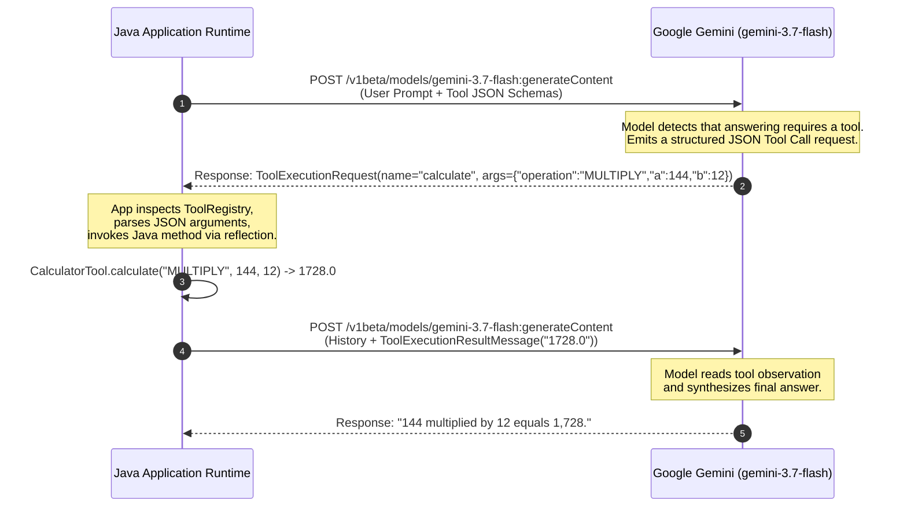
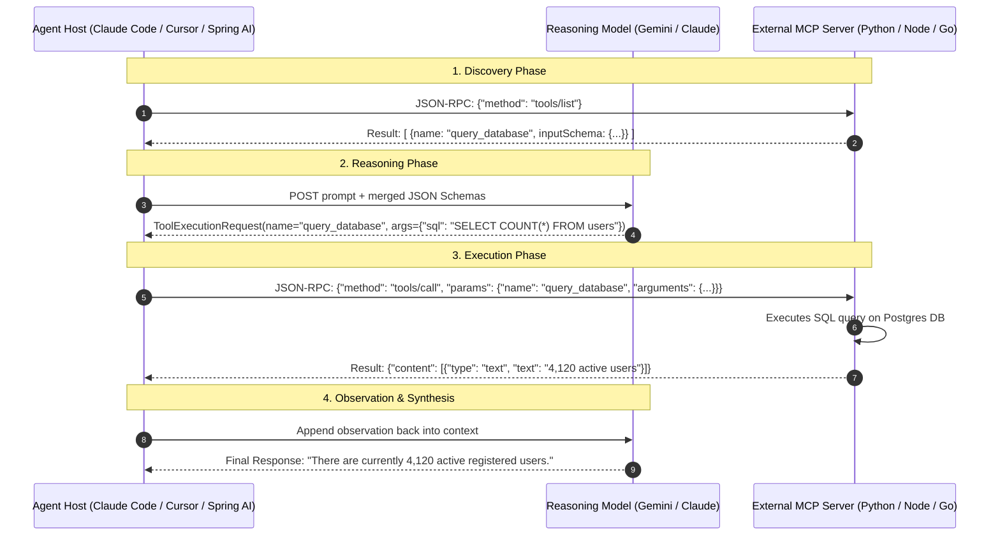

# 02. How Tool Calling Works (JSON Schema & Method Dispatch)

## 1. The Myth: "LLMs Execute Code"

A frequent misconception among beginners is that when an LLM is given a tool, it directly executes the tool's code inside its own runtime. 

**This is not what happens.**

An LLM is strictly a text-and-token processor. It cannot open a socket, run a Java method, or access your filesystem. Instead, **Tool Calling (or Function Calling)** is a structured negotiation protocol between the model and the host runtime:



---

## 2. Converting Java Code to JSON Schemas

How does Gemini know what tools exist and what parameters they require?

In LangChain4j, we annotate standard Java methods with `@Tool` and parameters with `@P`:

```java
@Component
public class CalculatorTool {

    @Tool("Performs basic arithmetic operations: ADD, SUBTRACT, MULTIPLY, DIVIDE on two numbers.")
    public double calculate(
            @P("The mathematical operation to perform: ADD, SUBTRACT, MULTIPLY, or DIVIDE") String operation,
            @P("The first operand (a)") double a,
            @P("The second operand (b)") double b
    ) {
        return switch (operation.toUpperCase().trim()) {
            case "ADD" -> a + b;
            case "MULTIPLY" -> a * b;
            // ...
        };
    }
}
```

LangChain4j inspects the class annotations and generates a **JSON Schema** sent in the model request:

```json
{
  "name": "calculate",
  "description": "Performs basic arithmetic operations: ADD, SUBTRACT, MULTIPLY, DIVIDE on two numbers.",
  "parameters": {
    "type": "object",
    "properties": {
      "operation": {
        "type": "string",
        "description": "The mathematical operation to perform: ADD, SUBTRACT, MULTIPLY, or DIVIDE"
      },
      "a": {
        "type": "number",
        "description": "The first operand (a)"
      },
      "b": {
        "type": "number",
        "description": "The second operand (b)"
      }
    },
    "required": ["operation", "a", "b"]
  }
}
```

---

## 3. Method Dispatch & Type Conversion (`ToolRegistry.java`)

When the model returns a `ToolExecutionRequest`:
1. `request.name()` $\rightarrow$ `"calculate"`
2. `request.arguments()` $\rightarrow$ `'{"operation": "MULTIPLY", "a": 144, "b": 12}'`

Our `ToolRegistry.java` takes this raw JSON string, maps each JSON key to the corresponding Java method parameter types (`double`, `String`, `int`, etc.), invokes the method via reflection, and measures execution time in milliseconds:

```java
RegisteredTool registered = toolsByName.get(request.name());
Object[] args = parseArguments(registered.method(), request.arguments());
Object output = registered.method().invoke(registered.targetInstance(), args);
```

---

## 4. Handling Tool Errors & Hallucinations

What happens if a tool throws an exception (e.g. division by zero or invalid file path)?

In our transparent engine:
1. The exception is caught cleanly.
2. The error message is formatted as an observation: `"ERROR: Division by zero is undefined."`
3. The observation is fed back to the LLM as a `ToolExecutionResultMessage`.
4. The LLM reads the error and can either:
   - Attempt a corrected tool call (self-correction).
   - Inform the user politely that the operation failed.

---

## 5. From Local Tools to MCP (Model Context Protocol): Two Sides of the Same Coin

Once you understand how local Java `@Tool` calling works, you already understand the **Model Context Protocol (MCP)**.

MCP does not introduce a new reasoning paradigm. It takes the exact same tool-calling and observation loop we just demystified and decouples it across process or network boundaries using **JSON-RPC 2.0** over `stdio` (pipes) or `SSE` (HTTP streams):



### Why MCP and Agents are Inseparable:
* **The Agent is the Brain & Loop:** The agent owns the iterative cognition—assessing user goals, deciding which tool to call, managing context memory, handling failure loops, and knowing when the task is complete.
* **MCP is the Universal Interface ("The USB-C Cable"):** MCP standardizes the connection between that brain and external systems. An agent runtime (whether in Java, TypeScript, or Rust) can instantly connect to pre-built MCP servers for GitHub, PostgreSQL, Docker, or Google Cloud without writing custom API adapters.
* **The Three Core MCP Primitives:**
  1. **Tools:** Executable actions that alter state or fetch dynamic data (`tools/call`).
  2. **Resources:** Passive readable context, URIs, and file streams (`resources/read`).
  3. **Prompts:** Reusable workflow templates and interactive prompt slash commands (`prompts/get`).
