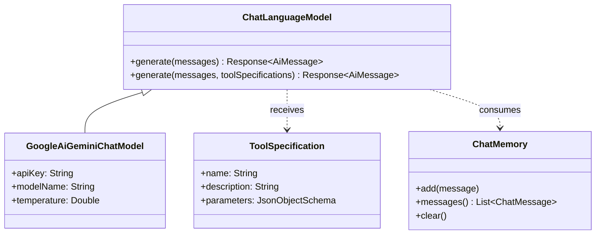

# 03. LangChain4j Architecture & Comparison

## 1. LangChain4j Core Abstractions

LangChain4j is designed to provide clean, type-safe Java abstractions for LLM applications.

The four pillars of LangChain4j used in this workshop are:



1. **`ChatLanguageModel`**: The unified interface for invoking models (OpenAI, Gemini, Anthropic, Ollama).
2. **`ToolSpecification`**: A framework-agnostic description of a function/tool and its JSON Schema.
3. **`ChatMessage`**: Polymorphic message hierarchy (`SystemMessage`, `UserMessage`, `AiMessage`, `ToolExecutionResultMessage`).
4. **`ChatMemory`**: Manages message eviction and context retention.

---

## 2. High-Level `AiServices` vs. Low-Level ReAct Loop

In LangChain4j, there are two primary ways to implement an agent:

### Approach A: High-Level `AiServices` (Declarative)
```java
interface Assistant {
    String chat(@UserMessage String message);
}

Assistant assistant = AiServices.builder(Assistant.class)
    .chatLanguageModel(model)
    .tools(new CalculatorTool(), new SystemInfoTool())
    .chatMemory(MessageWindowChatMemory.withMaxMessages(10))
    .build();

String response = assistant.chat("What is 144 * 12?");
```
*Pros:* Extremely concise, 5 lines of code.  
*Cons for Education:* The entire tool execution loop, reflection, and observation injection happens internally inside LangChain4j, making it hard for learners to see *why* and *how* steps execute.

### Approach B: Our Transparent Workshop Engine (`TransparentAgentEngine.java`)
We write the explicit `while (loopIteration < maxSteps)` loop in Java:
- We explicitly invoke `chatLanguageModel.chat(chatRequest)`.
- We explicitly inspect `aiMessage.hasToolExecutionRequests()`.
- We measure exact execution milliseconds per tool call.
- We emit live UI events (`AgentStepEvent`) over Server-Sent Events (SSE).
- We persist JSONL audit logs to disk.

---

## 3. Configuring Google Gemini (`gemini-3.7-flash`)

In `AgentConfig.java`:
```java
GoogleAiGeminiChatModel.builder()
    .apiKey(resolvedKey.key())
    .modelName("gemini-3.7-flash")
    .temperature(0.2)
    .maxRetries(3)
    .timeout(Duration.ofSeconds(60))
    .logRequestsAndResponses(true)
    .build();
```

### Flexible Key Resolution (`ApiKeyResolver.java`):
To make running workshops effortless across varied participant environments, the key is resolved with the following priority:
1. Environment variable: `GEMINI_API_KEY` or `GOOGLE_API_KEY`
2. JVM system property: `-Dgemini.api-key=...`
3. Local file: `./api.key` (or `./.api.key` or `~/.gemini/api.key`)
4. Spring configuration: `gemini.api-key` in `application.yml`
5. Offline Mock fallback (`MockLanguageModel`) if no key is supplied.
