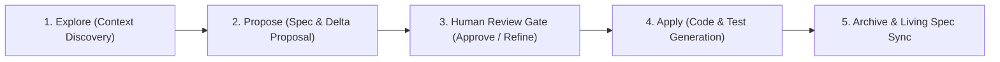

# 06. How to Do Quality Work with Agents: History, Context, Specs & Workflows

## 🎯 Executive Overview

Anyone can type a prompt into an AI chat and get plausible code. However, building reliable, production-grade software with AI agents requires transitioning from amateur **"vibe prompting"** to disciplined, deterministic software engineering.

High-performing teams ground their agent interactions in four essential pillars:

```
┌────────────────────────────────────────────────────────────────────────┐
│               THE 4 PILLARS OF HIGH-QUALITY AGENTIC WORK               │
├────────────────────────────────────────────────────────────────────────┤
│ 1. HISTORY    │ Ephemeral Working Memory vs. Durable State             │
│               │ Attention Dilution, Sunk-Cost Traps & Reset Discipline │
├───────────────┼────────────────────────────────────────────────────────┤
│ 2. CONTEXT    │ Context Hygiene, Exclusion Files (.claudeignore)       │
│               │ Prompt Caching (90% Savings) & HANDOFF.md Flushing     │
├───────────────┼────────────────────────────────────────────────────────┤
│ 3. SPECS      │ Spec-Driven Development (OpenSpec): Explore-Propose-Apply│
│               │ Specifications as Truth; Code & Tests as Derivatives   │
├───────────────┼────────────────────────────────────────────────────────┤
│ 4. WORKFLOWS  │ Pre-Flight Planning Gate & Characterization Safety Net │
│               │ 6-Step Escalation Protocol & 4-Point AI Code Review    │
└────────────────────────────────────────────────────────────────────────┘
```

---

## 1. Pillar 1: History — Managing the Double-Edged Sword

### The Illusion of Infinite Context
In modern LLMs with 200,000+ token context windows, developers often assume they can keep chatting in a single thread indefinitely. This is a dangerous mistake.
* **Attention Dilution & "Lost in the Middle":** As a conversation accumulates 20, 30, or 50 turns, the model's effective attention dilutes. Key architectural constraints or negative guardrails stated in Turn 1 become deprioritized relative to recent messages.
* **The Hallucination Cascade:** Discarded hypotheses, misleading compiler stack traces, and broken code snippets remain permanently in history. The model anchors on its own prior mistakes, frequently resurrecting buggy patterns it already tried to fix.
* **The Sunk-Cost Prompt Trap:** When an agent fails to solve a bug, human developers instinctively reply *"try again"*, *"fix the compile error"*, or *"are you sure?"*. By the 4th attempt, the context is thoroughly poisoned, and the model begins thrashing or hallucinating wildly.

### The Golden Discipline of History
1. **History is Working Memory, Not Project State:** Durable project state belongs in version-controlled files (`git`), specifications (`openspec/`), and knowledge items (`.knowledge/`). Conversation history is disposable scratchpad memory.
2. **The Rule of 3 (Circuit Breaker):** If an agent fails to solve a bug after **2–3 attempts**, HALT execution immediately. Continuing to prompt in the same thread guarantees context degradation.
3. **Revert and Reset:** Wipe dirty edits with `git restore .`, export diagnostic findings into a fresh handoff, and start a clean session.

---

## 2. Pillar 2: Context — Hygiene, Economics & The Zero-Baggage Handoff

### Context Poisoning vs. Strict Hygiene
* **Context Poisoning:** If an agent blindly ingests build outputs (`target/`, `node_modules/`), binaries, generated minified assets, or noisy logs, its reasoning degrades. The model confuses obsolete generated classes with source code.
* **Exclusion Guardrails:** Configure repository exclusion files (`.claudeignore`, `.cursorignore`, `.gitignore`) so agents are physically restricted to source files and documentation.
* **Selective File Reading:** Demand that agents read only relevant files and interfaces, rather than dumping entire packages into context.

### Token Economics & Provider Prompt Caching
* **Cost Disparity:** Output tokens cost $3\times\text{--}5\times$ more than input tokens. Minimizing long agent monologues and focusing on structured tool executions saves significant cost.
* **Prompt Caching Dynamics:** Leading AI providers (Anthropic Claude, Google Gemini, OpenAI) automatically cache static prompt prefixes:
  * Static system prompts, unchanging tool schemas, and repository guidelines achieve **up to 90% cost savings** and **80% latency reductions** on cached turns.
  * Invariant: Never insert dynamic timestamps, random IDs, or changing counters at the top of your system prompt; doing so invalidates the cache on every turn!

### The Markdown Checkpoint Pattern (`HANDOFF.md`)
* **The Trap of CLI Resume:** Using native session resumption (e.g., `claude --resume`) restores accumulated token baggage and cognitive bias.
* **The Zero-Baggage Handoff:**
  Before concluding a long task or when context approaches 50,000+ tokens, command the agent:
  > *"Generate a structured summary of our work: completed changes, architectural decisions made, current modified files, and exact next steps in a `HANDOFF.md` format."*
* Opening a fresh chat session with `HANDOFF.md` provides **100% state continuity with 0 token baggage**, flushing 100,000 tokens down to 2,000 tokens.

---

## 3. Pillar 3: Specs — Spec-Driven Development (OpenSpec)

### The Fallacy of "Vibe Prompting"
Asking an agent to build a multi-file feature from an ad-hoc conversational prompt (e.g. *"Build an API rate limiter with an in-memory cache and admin UI"*) is guaranteed to fail. The agent jumps immediately into code, invents non-existent APIs, misses concurrency invariants, and produces broken diffs.

### The OpenSpec Framework: Explore $\rightarrow$ Propose $\rightarrow$ Apply
In Spec-Driven Development (SDD), specifications are the **durable source of truth**; code and tests are derivative artifacts.



1. **Step 1: Explore:** The agent inspects existing interfaces, dependencies, and constraints without writing code.
2. **Step 2: Propose (`openspec/changes/<change-name>/`):**
   * `proposal.md`: Problem statement, architecture approach, and explicit non-goals.
   * `delta-spec.md`: Concrete capability changes categorized by `ADDED`, `MODIFIED`, and `REMOVED`.
   * `tasks.md`: Phased execution checklist with verification commands.
3. **Step 3: Human Review Gate:** The human engineer reads the proposed specification and approves or adjusts the contract *before* any implementation begins.
4. **Step 4: Apply:** The agent writes the code and tests against the approved spec.
5. **Step 5: Archive & Sync:** The change proposal is merged into the living specification library (`openspec/specs/`).

### Why Spec-First Works (The Review ROI)
* Reviewing a 1-page markdown specification takes a human engineer **2 minutes**.
* Reviewing and untangling a broken, hallucinatory 500-line git diff takes **45 minutes**.
* Forcing the agent to write the specification first compels the LLM to construct a complete internal reasoning model before touching code.

---

## 4. Pillar 4: Workflows — Deterministic Quality Gates

To produce reliable code, teams embed five mandatory quality gates into their daily agent interactions:

### Gate 1: Pre-Flight Planning Gate (`implementation_plan.md` / ADR)
For any task touching more than one file or modifying architecture, the agent is strictly barred from editing code until it authors a design plan detailing:
1. *User Review Required:* Non-obvious trade-offs or breaking changes.
2. *Open Questions:* Ambiguities needing human clarification.
3. *Proposed File Changes:* Labeled with `[NEW]`, `[MODIFY]`, or `[DELETE]`.
4. *Verification Plan:* Automated test commands and manual verification steps.

### Gate 2: Characterization Testing Safety Net
Never allow an agent to refactor legacy code without an immutable safety net:
1. Direct the agent to write a **Characterization Test Suite** that exercises the current code across all branches, boundary values, and error states.
2. Run the tests to confirm 100% pass rate.
3. Lock the tests as immutable: the agent is forbidden from editing the tests while refactoring the implementation.

### Gate 3: The 6-Step Escalation Protocol (When Stuck)
When an agent enters a failure loop, follow the standardized escalation protocol:
1. **Circuit Breaker:** Stop typing prompts; halt execution immediately.
2. **Revert Workspace:** Run `git restore .` to discard messy thrashing edits.
3. **Shift to Pure Diagnostic Mode:** Command the agent to formulate 3 distinct testable hypotheses without writing code.
4. **De-escalate to MRE:** Isolate the failure into a minimal reproducible example (a 10-line standalone test).
5. **Flush Context:** Export findings to `HANDOFF.md` and launch a clean chat session.
6. **Invert the Initiative:** Prompt the agent to interview you (`/grill-me`) on missing business constraints.

### Gate 4: The 4-Point AI Code Review Checklist
Never trust AI-generated code simply because automated tests pass. Human code review must verify four critical invariants:
1. **[ ] Algorithmic Complexity Check:** Did the AI replace an $O(1)$ hash map lookup with an accidental $O(n)$ stream filter inside a hot path?
2. **[ ] Allocation & GC Pressure Check:** Is the AI creating temporary boxed primitives, strings, or stream collectors in tight loops?
3. **[ ] Concurrency & Memory Model Check:** Are shared fields properly marked `volatile`, protected by atomic references, or synchronized with deterministic lock ordering?
4. **[ ] Test Mutilation Guard:** Did the AI pass tests by silently weakening assertions, deleting edge-case checks, or hardcoding return values?

### Gate 5: Post-Flight Walkthroughs & Knowledge Harvesting
* **Walkthrough Gate:** Require the agent to produce a structured `walkthrough.md` summarizing modified files, rationale, and exact test execution outputs.
* **Continuous Knowledge Harvesting:** Whenever an agent navigates a tricky framework quirk, solves a subtle bug, or establishes a UI pattern, command:
  > *"Harvest what we just solved into a new Knowledge Item in `.knowledge/<topic>/` with a clear summary so future agent sessions never repeat this research."*
